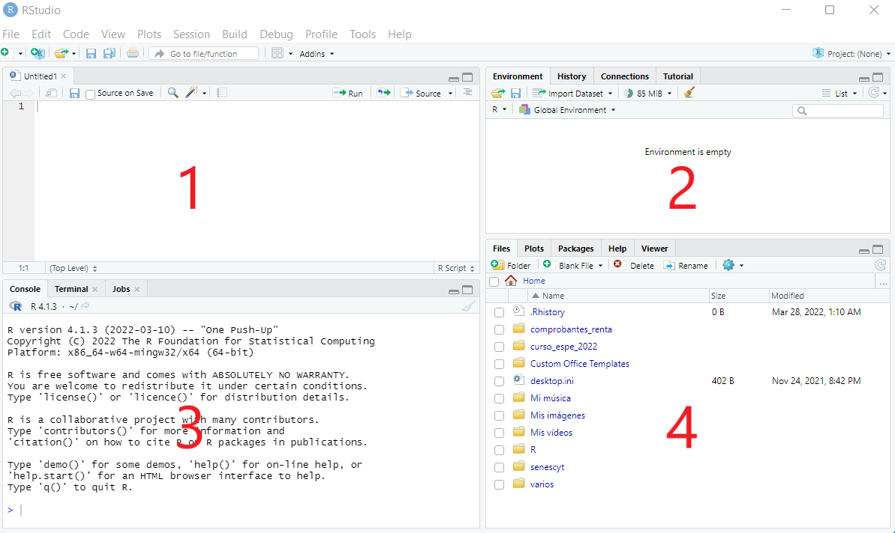
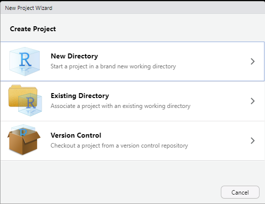
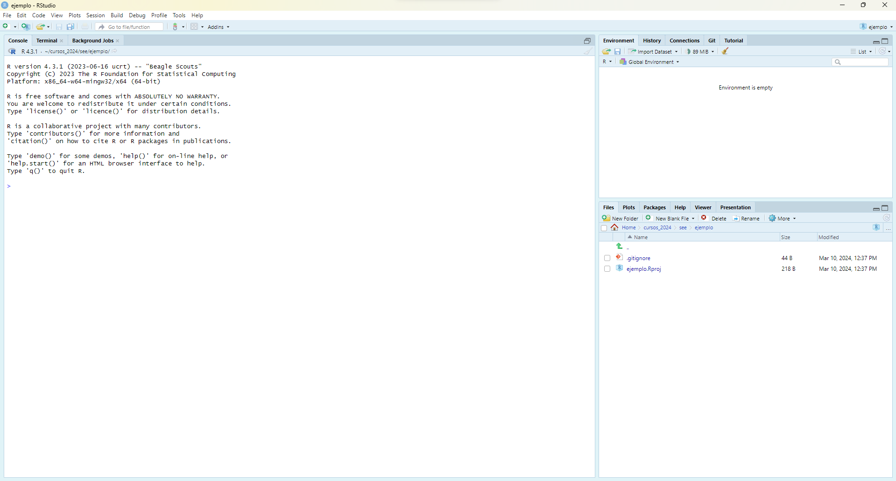
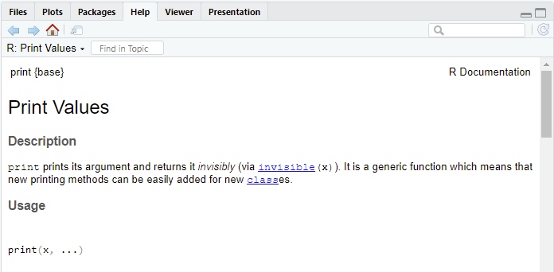
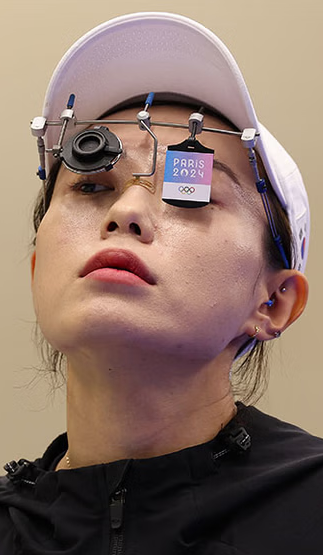

## {}

::: columns
::: {.column width="37.5%"}
{style="margin-left:-40px"}
:::

::: {.column width="60%"}
::: {.title data-id="title"}
Módulo 1: Generalidades e introducción a R
:::

Mauricio Moreno, PhD


:::
:::

{.image-left}

## Acerca del curso {.smaller}

::: incremental
-   Cuatro sesiones, de : **, ,  y **.
-   Todo el material está en la [página web del curso](../index.html){target="_blank"}: estas diapositivas, ejercicios interactivos, autoevaluaciones y recursos.
-   Los ejercicios corren **en el navegador**: puedes practicar aunque todavía no tengas R instalado.
-   Evaluación: **40%** ejercicios en clase y **60%** examen virtual. Con **7/10** obtienes el certificado de aprobación.
-   Preguntas fuera de clase: **mmorenozambrano\@gmail.com**
:::

## Hoy

1.  R, RStudio y los proyectos de R
2.  Reglas de sintaxis, tipos de datos y operadores
3.  Objetos: vectores, factores, tablas de datos y listas
4.  Paquetes e importación de datos
5.  Operaciones estadísticas básicas

. . .

Entre cada bloque, **ejercicios** en la página del curso.

# R y RStudio

## ¿Por qué R? {.smaller}

::: columns
::: {.column width="50%"}
{target="_blank"}](images/use.jpg){fig-align="center"}
:::

::: {.column width="50%"}
::: incremental
-   Es **gratuito** y de código abierto.
-   Tiene más de 20 000 paquetes para casi cualquier análisis.
-   Es el estándar en muchas áreas de la biología, la agronomía y la salud.
-   Todo queda escrito en un **script**: el análisis se puede repetir, revisar y compartir.
-   Una comunidad enorme, también en español.
:::
:::
:::

## Instalación de R y RStudio {.smaller}

Se instalan **en este orden**:

1.  **R**, desde [CRAN](https://cran.r-project.org/){target="_blank"}: es el lenguaje, el que hace los cálculos.
2.  **RStudio Desktop**, desde [Posit](https://posit.co/download/rstudio-desktop/){target="_blank"}: es el entorno donde escribimos y ejecutamos el código.

. . .

::: callout-tip
La guía paso a paso está en la sección [Recursos](../recursos.html#instalacion){target="_blank"} de la página del curso.
:::

## RStudio

{fig-align="center"}

## Los cuatro paneles {.smaller}

::: incremental
-   **Script** (arriba a la izquierda): donde escribimos el código que queremos guardar. `Ctrl + Enter` ejecuta la línea actual.
-   **Consola** (abajo a la izquierda): donde R ejecuta el código y muestra los resultados.
-   **Entorno** (arriba a la derecha): los objetos que hemos creado.
-   **Archivos, gráficos, paquetes y ayuda** (abajo a la derecha).
:::

# Proyectos de R

## ¿Por qué un proyecto? {.smaller}

::: incremental
-   Un **proyecto de R** es una carpeta con un archivo `.Rproj`.
-   Al abrirlo, RStudio fija esa carpeta como **carpeta de trabajo**.
-   Así podemos usar **rutas relativas**: `"datos/pinguinos.csv"` en lugar de `"C:/Users/Mauricio/Documentos/curso/datos/pinguinos.csv"`.
-   El mismo código funciona en tu computador, en el mío y en el de un colega.
:::

## Creando un proyecto {.smaller}

::: columns
::: {.column width="40%"}
{fig-align="center"}
:::

::: {.column width="60%"}
1.  *File* (Archivo) → *New Project...* (Nuevo proyecto...)
2.  *New Directory* (Nuevo directorio)
3.  *New Project* (Nuevo proyecto)
4.  Elegimos el nombre de la carpeta y dónde crearla.
:::
:::

## Creando un proyecto {visibility="uncounted"}

{fig-align="center"}

## Una estructura sencilla {.smaller}

::: columns
::: {.column width="45%"}
```
curso_R/
├── curso_R.Rproj
├── datos/
│   └── pinguinos.csv
├── scripts/
│   └── modulo_1.R
└── resultados/
```
:::

::: {.column width="55%"}
::: incremental
-   `datos/`: los datos originales. **No se modifican a mano.**
-   `scripts/`: el código, un archivo por tarea o por sesión.
-   `resultados/`: tablas y gráficos que produce el código.
:::
:::
:::

# Sintaxis, tipos de datos y operadores

## Reglas generales {.smaller}

::: incremental
-   R distingue mayúsculas y minúsculas: `Tabla` y `tabla` son objetos distintos.
-   Asignamos con `<-` (también funciona `=`): `x <- 5`.
-   Los nombres no pueden empezar con un número ni tener espacios: mejor `masa_final` que `masa final`.
-   Todo lo que va después de `#` es un **comentario**: R no lo ejecuta.
-   Evitemos nombres que ya usa R, como `T`, `F`, `c` o `mean`.
:::

. . .

```{r}
# Largo del pico de un pingüino, en mm
pico <- 39.1
pico * 2
```

## Tipos de datos

| Tipo | Ejemplo | Para qué |
|:--|:--|:--|
| `numeric` | `39.1`, `-3` | mediciones |
| `integer` | `5L` | conteos |
| `character` | `"Hi"`, `"control"` | texto |
| `logical` | `TRUE`, `FALSE` | sí o no |
| `factor` | `factor(c("C", "L"))` | grupos o tratamientos |

. . .

```{r}
class(39.1)
class("control")
```

## Operadores {.smaller}

::: columns
::: {.column width="33%"}
**Aritméticos**

`+  -  *  /  ^`

```{r}
2^10
(4050 - 3750) / 3750 * 100
```
:::

::: {.column width="33%"}
**De comparación**

`==  !=  <  >  <=  >=`

```{r}
5 == 5
5 != 3
```
:::

::: {.column width="33%"}
**Lógicos**

`&` (y), `|` (o), `!` (no)

```{r}
(5 > 3) & (2 > 4)
(5 > 3) | (2 > 4)
```
:::
:::

# Objetos

## Vectores {.smaller}

Un vector guarda varios valores **del mismo tipo**. Se crea con `c()`.

```{r}
masas <- c(3750, 3800, 3250, 3450, 3650)
length(masas)
masas[2]
masas[masas > 3500]
```

. . .

Las operaciones se aplican a **todos** los elementos:

```{r}
masas / 1000
```

## Factores {.smaller}

Un factor es un vector de grupos, con **niveles**.

```{r}
especie <- factor(c("Adelie", "Gentoo", "Chinstrap", "Adelie", "Gentoo"))
especie
levels(especie)
table(especie)
```

. . .

Las especies, las islas y los tratamientos de un experimento son factores. En `{ggplot2}`, los factores definen colores y grupos.

## Tablas de datos {.smaller}

Un `data.frame` es una tabla: cada columna es un vector, y todas tienen el mismo largo.

```{r}
aves <- data.frame(
  id = c(1, 2, 3),
  especie = c("Adelie", "Gentoo", "Chinstrap"),
  masa = c(3750, 5500, 3700)
)
aves
```

. . .

```{r}
aves$masa          # una columna, con $
aves[2, ]          # una fila: [fila, columna]
aves[3, "masa"]    # un valor
```

## Listas {.smaller}

Una lista guarda objetos **de cualquier tipo**, incluso otras tablas.

```{r}
estudio <- list(nombre = "Palmer", aves = 344, tabla = aves)
estudio$aves
```

. . .

Muchos resultados de R son listas; un gráfico de `{ggplot2}` también lo es.

# Operaciones básicas en R

## Operaciones aritméticas {.smaller}

::: incremental
-   Podemos llevar a cabo las cinco operaciones básicas sobre la totalidad de elementos numéricos de un objeto sin mayor inconveniente. Ejemplo:
:::

. . .

```{r echo=T, eval=T, error=T}
a <- c(10, 20, -50, -10, 0)
a / 100
a * 10
a + 30
a - 30
a ^ 2
```

## Operaciones lógicas {.smaller}

::: incremental
-   De manera similar, los operadores lógicos también actúan sobre cada elemento de un objeto
:::

. . .

```{r echo=T, eval=T, error=T}
a <- c(10, 20, -50, -10, 0)
a > 0
a >= 0
a == 0
a != 0
a < 0
a <= 0
```

## Concatenación de vectores {.smaller}

::: incremental
-   Podemos también concatenar uno o más objetos a un vector preexistente. Esto es útil, por ejemplo, al crear nuestras propias funciones. Veamos un ejemplo sencillo:
:::

. . .

```{r echo=T, eval=T, error=T}
b <- c(a, 2)
b
extra <- c(3, 5)       # no lo llamamos c: ese nombre ya lo usa la función c()
d <- c(a, b, extra)
d
```

## Creación de factores {.smaller}

::: incremental
-   Es muy importante el especificar cuando una variable es un factor.

-   Como mencioné anteriormente, R reconocerá de manera automática como carácter cualquier valor que no sea numérico.

-   En caso de usar como factor una variable que R reconoce únicamente como carácter, R realizará todo análisis que le pidamos utilizando el orden alfabético de la variable como el orden de los niveles del factor. Esto puede ser problemático si:

    -   Queremos que los niveles del factor tengan un orden específico.

    -   Las pruebas estadísticas que realicemos requieren especificar un nivel como referencia.

    -   Queremos controlar el orden de las barras, las cajas o la leyenda en un gráfico: `{ggplot2}` usa el orden de los niveles.
:::

## Creación de factores {visibility="uncounted" .smaller}

**Factor ordenado alfabéticamente**

```{r echo=T, eval=T, error=T}
#| include: true
variable_factor_1 <- c("Gentoo", "Adelie", "Adelie", "Chinstrap", "Gentoo", "Adelie")
variable_factor_1 <- factor(variable_factor_1)
str(variable_factor_1)
```

. . .

**Factor con orden distinto al alfabético**

. . .

```{r echo=T, eval=T, error=T}
#| include: true
variable_factor_2 <- c("Gentoo", "Adelie", "Adelie", "Chinstrap", "Gentoo", "Adelie")
variable_factor_2 <- factor(variable_factor_2, levels = c("Gentoo", "Chinstrap", "Adelie"))
str(variable_factor_2)
```

. . .

Si tuviésemos muchos niveles del factor, y solo estamos interesados en que uno de ellos sea la referencia:

```{r echo=T, eval=T, error=T}
#| include: true
variable_factor_2 <- c("Gentoo", "Adelie", "Adelie", "Chinstrap", "Gentoo", "Adelie")
variable_factor_2 <- relevel(factor(variable_factor_2), ref = "Gentoo")
str(variable_factor_2)
```

## Transformación de valores {.smaller}

::: incremental
-   Las transformaciones más comunes de valores son a valores numéricos, caracteres y fechas.

-   Para esto usaremos las funciones `as.numeric()`, `as.character()` y `as.Date()`, respectivamente.
:::

. . .

**Ejemplo** `as.numeric`. A veces, al importar datos, R toma valores numéricos como caracteres (una causa común es marcar los valores perdidos con texto en el archivo de origen).

. . .

```{r echo=T, eval=T, error=T}
#| include: true
#| code-line-numbers: "1|2"
trans_num <- c(1, 2, "NA", 3, 4)
str(trans_num)
```

. . .

```{r echo=T, eval=T, error=T}
#| include: true
#| code-line-numbers: "1|2"
trans_num <- as.numeric(trans_num)
str(trans_num)
```

. . .

**Ejemplo** `as.character`.

```{r echo=T, eval=T, error=T}
#| include: true
#| code-line-numbers: "1|2|3"
str(variable_factor_2)
variable_factor_2 <- as.character(variable_factor_2)
str(variable_factor_2)
```

## Transformación de valores {.smaller visibility="uncounted"}

**Fechas**

::: incremental
-   La transformación de caracteres a fechas depende enormemente de los distintos formatos que existen para denotar una y de las unidades que se usan.

-   Por tanto, no existe una solución única. Aquí abarcaremos el caso más sencillo en que el formato es YYYY-MM-DD.

-   La función base `as.Date()` abarca una gran diversidad de capacidades para transformar fechas. Sin embargo, su uso puede resultar un poco confuso. En caso de que necesites una solución más específica, recomiendo el paquete `{lubridate}` del conjunto de paquetes `{tidyverse}`.
:::

. . .

**Ejemplo** `as.Date`

```{r echo=T, eval=T, error=T}
#| include: true
#| code-line-numbers: "1|2|3|4"
fechas <- c("1985-10-14", "2021-12-25", "2023-01-01", "1999-05-06", "1900-01-02")
str(fechas)
fechas <- as.Date(fechas)
str(fechas)
```


## {}

::: columns
::: {.column width="37.5%"}
:::

::: {.column width="60%"}
::: {.title data-id="title"}
[Ejercicios, Parte 1](../ejercicios-1.html#parte-1){target="_blank"}
:::

::: {.timer #Timer1 seconds=900 starton=interaction}
:::
:::
:::

{.image-left}

# Paquetes e importación de datos

## Paquetes {.smaller}

::: incremental
-   Un **paquete** agrega funciones a R. Se descargan de [CRAN](https://cran.r-project.org/){target="_blank"}.
-   Se **instalan una sola vez** en tu computador:
:::

. . .

```{r}
#| eval: false
install.packages("readxl")
```

. . .

::: incremental
-   Se **cargan en cada sesión** en que los uses:
:::

. . .

```{r}
#| eval: false
library(readxl)
```

## Ayuda en R {.smaller}

::: columns
::: {.column width="45%"}
```{r}
#| eval: false
?mean
help(sd)
example(mean)
```

::: incremental
-   La ayuda explica los **argumentos** de cada función y trae ejemplos al final.
-   Un mensaje de error copiado en un buscador casi siempre tiene respuesta.
:::
:::

::: {.column width="55%"}
{fig-align="center"}
:::
:::

## Importar un archivo csv {.smaller}

En tu proyecto, con el archivo en la carpeta `datos/`:

```{r}
pinguinos <- read.csv("datos/pinguinos.csv")
```

. . .

Lo primero, siempre: revisar lo que importamos.

```{r}
str(pinguinos)
```

## Importar un archivo de Excel {.smaller}

```{r}
#| eval: false
library(readxl)
pinguinos <- read_excel("datos/pinguinos.xlsx", sheet = 1)
```

. . .

::: callout-tip
## Antes de importar

-   Una fila por observación y una columna por variable.
-   Nombres de columna cortos, sin espacios ni tildes.
-   Sin celdas combinadas, colores ni totales al final.
:::

## Los datos del curso {.smaller}

`pinguinos.csv`: 344 pingüinos del archipiélago Palmer, Antártida (Gorman y estación Palmer LTER, paquete `{palmerpenguins}`, licencia CC0).

| Variable | Qué es |
|:--|:--|
| `species` | especie: Adelie, Chinstrap, Gentoo |
| `island` | isla: Biscoe, Dream, Torgersen |
| `bill_length_mm`, `bill_depth_mm` | largo y profundidad del pico (mm) |
| `flipper_length_mm` | largo de la aleta (mm) |
| `body_mass_g` | masa corporal (g) |
| `sex` | sexo: female, male |
| `year` | año de la medición: 2007, 2008, 2009 |

## {}

::: columns
::: {.column width="37.5%"}
:::

::: {.column width="60%"}
::: {.title data-id="title"}
[Ejercicios, Parte 2](../ejercicios-1.html#parte-2){target="_blank"}
:::

::: {.timer #Timer2 seconds=600 starton=interaction}
:::
:::
:::

{.image-left}

# Operaciones estadísticas básicas

## Valores faltantes {.smaller}

En los datos reales casi siempre falta algo. En R, un valor faltante es `NA`.

```{r}
summary(pinguinos$body_mass_g)
mean(pinguinos$body_mass_g)
```

. . .

R no puede calcular la media si falta un dato. Le pedimos que lo ignore con `na.rm = TRUE`:

```{r}
mean(pinguinos$body_mass_g, na.rm = TRUE)
sum(is.na(pinguinos$body_mass_g))
```

## Tendencia central y dispersión {.smaller}

```{r}
median(pinguinos$body_mass_g, na.rm = TRUE)
sd(pinguinos$body_mass_g, na.rm = TRUE)
quantile(pinguinos$body_mass_g, na.rm = TRUE)
```

. . .

$$
s = \sqrt{\frac{\sum_{i=1}^{n}(x_i - \bar{x})^2}{n - 1}}
$$

## Resumir por grupos {.smaller}

```{r}
tapply(pinguinos$body_mass_g, pinguinos$species, mean, na.rm = TRUE)
```

. . .

```{r}
aggregate(body_mass_g ~ species, data = pinguinos, FUN = mean)
```

`aggregate()` con fórmula descarta las filas con `NA` por su cuenta.

## Variables categóricas {.smaller}

```{r}
table(pinguinos$species)
prop.table(table(pinguinos$species))
table(pinguinos$species, pinguinos$island)
```

. . .

¿Qué nos dice la tabla cruzada? Los Gentoo solo están en Biscoe y los Chinstrap solo en Dream. En el [Módulo 2](modulo-2.html) haremos esto mismo con `{dplyr}` y lo veremos en un gráfico.

## Otras formas de calcular estadísticos descriptivos {.smaller}

::: incremental
-   La forma más sencilla de calcular los estadísticos descriptivos de una tabla de datos es la función base `summary()`.
:::

. . .

```{r}
summary(pinguinos)
```

## Estadísticos descriptivos {.smaller visibility="uncounted"}

::: incremental
-   `summary()` resulta útil para hacer chequeos sobre la marcha, y además cuenta los `NA` de cada columna.

-   Para obtener una tabla de estadísticos descriptivos lista para presentar resultados, usaremos dos funciones del paquete `{tidycomm}`:

    -   `describe()`: tablas de estadísticos descriptivos de variables cuantitativas

    -   `describe_cat()`: tablas de estadísticos descriptivos de variables categóricas
:::

. . .

```{r}
library(tidycomm)
describe(pinguinos)
```

. . .

```{r}
describe_cat(pinguinos)
```

## Tablas de frecuencia {.smaller}

::: incremental
-   Existen dos formas de crear tablas de frecuencia:

    -   A partir de variables categóricas

    -   Categorizando una variable continua

-   Usualmente se presentan:

    -   Frecuencia absoluta: número de observaciones por categoría

    -   Frecuencia acumulada: suma de frecuencias absolutas

    -   Frecuencia relativa: frecuencia absoluta / total de observaciones

    -   Frecuencia relativa acumulada: suma de frecuencias relativas
:::

## Tablas de frecuencia {visibility="uncounted" auto-animate="true"}

::: incremental
-   A partir de una variable categórica
:::

. . .

```{r}
#| code-line-numbers: "1"
library(fdth)                     # {fdth} calcula tablas de frecuencia
```

## Tablas de frecuencia {visibility="uncounted" auto-animate="true"}

-   A partir de una variable categórica

```{r}
#| code-line-numbers: "2"
library(fdth)                     # {fdth} calcula tablas de frecuencia
tabla_frec1 <- fdt_cat(pinguinos$species)  # fdt_cat() hace la tabla de una variable categórica
```

## Tablas de frecuencia {visibility="uncounted" auto-animate="true"}

-   A partir de una variable categórica

```{r}
#| code-line-numbers: "3"
library(fdth)                     # {fdth} calcula tablas de frecuencia
tabla_frec1 <- fdt_cat(pinguinos$species)  # fdt_cat() hace la tabla de una variable categórica
tabla_frec1
```

. . .

-   f: frecuencia absoluta

-   rf: frecuencia relativa, rf(%): frecuencia relativa en %

-   cf: frecuencia acumulada, cf(%): frecuencia acumulada en %

## Tablas de frecuencia {visibility="uncounted" auto-animate="true"}

::: incremental
-   Categorizando una variable continua: la masa corporal (`body_mass_g`)
:::

. . .

```{r}
#| code-line-numbers: "1"
tabla_frec2 <- fdt(pinguinos$body_mass_g, na.rm = TRUE)
```

## Tablas de frecuencia {visibility="uncounted" auto-animate="true"}

-   Categorizando una variable continua: la masa corporal (`body_mass_g`)

```{r}
#| code-line-numbers: "2"
tabla_frec2 <- fdt(pinguinos$body_mass_g, na.rm = TRUE)
tabla_frec2
```

::: incremental
-   `{fdth}` divide la variable continua en clases con uno de tres algoritmos. El predeterminado es el de Sturges (ver `?fdt`).
:::

## ¿Cómo exporto mis tablas? {.smaller}

. . .

-   Existen varias opciones para exportar tablas a otros formatos (.pdf, .docx, .html). Por ejemplo, con `{flextable}`:

. . .

```{r}
#| eval: false
#| code-line-numbers: "1|2|3|4|5|6-7"
library(flextable)
ft1 <- flextable(tabla_frec1)
ft1 <- autofit(ft1)
ft2 <- flextable(tabla_frec2[[1]])   # tabla_frec2 es una lista: la tabla es su primer elemento
ft2 <- autofit(ft2)
save_as_docx("Tabla 1" = ft1, "Tabla 2" = ft2,
             path = "resultados/tablas.docx")
```

## {}

::: columns
::: {.column width="37.5%"}
:::

::: {.column width="60%"}
::: {.title data-id="title"}
[Ejercicios, Parte 3](../ejercicios-1.html#parte-3){target="_blank"}
:::

::: {.timer #Timer3 seconds=900 starton=interaction}
:::
:::
:::

{.image-left}

## Antes de la próxima sesión {.smaller}

::: incremental
1.  Crea tu **proyecto de R** para el curso, con las carpetas `datos/`, `scripts/` y `resultados/`.
2.  Completa **todos** los [ejercicios](../ejercicios-1.html){target="_blank"} del Módulo 1: lo que no alcanzamos en clase, incluida la Parte 4, es tarea.
3.  Importa tus propios datos y calcula sus estadísticos básicos.
4.  Haz la [autoevaluación](../autoevaluacion-1.html){target="_blank"} del Módulo 1.
:::

## {}

::: columns
::: {.column width="60%"}
::: {.title data-id="title"}
Fin del módulo 1
:::

::: callout-tip
## Créditos de fotos

Portada por <a href="https://unsplash.com/@becomes?utm_content=creditCopyText&utm_medium=referral&utm_source=unsplash">Becomes Co</a> en <a href="https://unsplash.com/photos/2-men-sitting-on-black-office-rolling-chairs-s_FHDDSVp1s?utm_content=creditCopyText&utm_medium=referral&utm_source=unsplash">Unsplash</a>

Foto final por <a href="https://unsplash.com/@wolfgang_hasselmann?utm_content=creditCopyText&utm_medium=referral&utm_source=unsplash">Wolfgang Hasselmann</a> en <a href="https://unsplash.com/photos/dandelion-flower-under-golden-hour-Kovuf0yU8NU?utm_content=creditCopyText&utm_medium=referral&utm_source=unsplash">Unsplash</a>

Resto de fotos: varias fuentes
:::
:::

::: {.column width="37.5%"}
{style="margin-left:125px"}
:::
:::

{.image-right}
