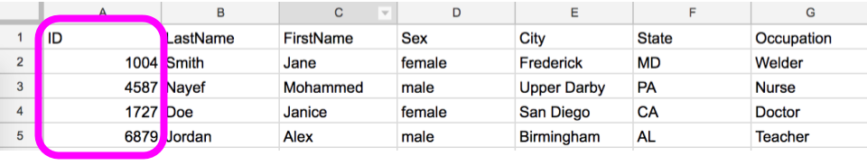
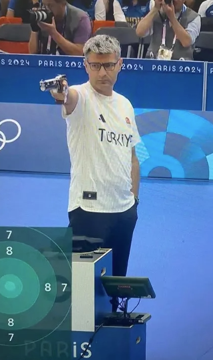

## {}

::: columns
::: {.column width="37.5%"}
{style="margin-left:-60px"}
:::

::: {.column width="60%"}
::: {.title data-id="title"}
Módulo 2: Introducción al `{tidyverse}` y a `{ggplot2}`
:::

Mauricio Moreno, PhD


:::
:::

{.image-left}

## Hoy

1.  El `{tidyverse}` y el operador de cascada
2.  Tipos de tablas: `tibble` y datos ordenados
3.  Operaciones con tablas en `{dplyr}`
4.  Introducción a `{ggplot2}`: función de inicio, geometrías, estéticas y capas

# El `{tidyverse}`

## ¿Qué es el `{tidyverse}`? {.smaller}

::: columns
::: {.column width="35%"}
{fig-align="center"}
:::

::: {.column width="65%"}
::: incremental
-   Una colección de paquetes que comparten una misma forma de trabajar con datos.
-   `{readr}` importa, `{tidyr}` ordena, `{dplyr}` transforma, `{ggplot2}` grafica.
-   Las funciones tienen nombres de **verbos**: `filter()`, `select()`, `mutate()`, `summarise()`.
-   Todas reciben una tabla como primer argumento y devuelven una tabla.
:::
:::
:::

. . .

```{r}
library(tidyverse)
```

## Los datos de hoy {.smaller}

```{r}
#| code-fold: true
pinguinos <- read_csv("datos/pinguinos.csv")
pinguinos
```

`read_csv()` (con guion bajo, de `{readr}`) devuelve un **tibble**.

## Tibbles {.smaller}

::: incremental
-   Un `tibble` es un `data.frame` moderno: se imprime mejor (solo las primeras filas y el tipo de cada columna) y nunca cambia los nombres de las columnas.
-   Todo lo que funciona con un `data.frame` funciona con un `tibble`.
-   Para convertir: `as_tibble(tabla)` y `as.data.frame(tabla)`.
:::

## El operador de cascada {.smaller}

Sin el operador, leemos de adentro hacia afuera:

```{r}
round(mean(pinguinos$body_mass_g, na.rm = TRUE), 1)
```

. . .

Con `|>`, leemos de izquierda a derecha, como una receta: "toma esto, **y luego** haz aquello".

```{r}
pinguinos$body_mass_g |>
  mean(na.rm = TRUE) |>
  round(1)
```

. . .

::: callout-tip
`x |> f(y)` es lo mismo que `f(x, y)`. En RStudio: `Ctrl + Shift + M`. También verás `%>%`, la versión de `{magrittr}`; para este curso funcionan igual.
:::

# Tipos de tablas

## Datos ordenados (*tidy data*) {.smaller}

::: columns
::: {.column width="50%"}
{fig-align="center"}
:::

::: {.column width="50%"}
::: incremental
1.  Cada **variable** es una columna.
2.  Cada **observación** es una fila.
3.  Cada **valor** está en su propia celda.
:::

. . .

`{ggplot2}` y `{dplyr}` esperan datos ordenados.
:::
:::

## Formato ancho y formato largo {.smaller}

```{r}
ancho <- tibble(especie = c("Adelie", "Gentoo"),
                `2007` = c(3700, 5070), `2008` = c(3740, 5020), `2009` = c(3670, 5140))
ancho
```

. . .

```{r}
largo <- ancho |>
  pivot_longer(cols = c(`2007`, `2008`, `2009`), names_to = "año", values_to = "masa_g")
largo
```

`pivot_wider()` hace el camino inverso.

# Operaciones con tablas en `{dplyr}`

## Filtrar filas: `filter()` {.smaller}

```{r}
pinguinos |>
  filter(species == "Gentoo", body_mass_g > 5500)
```

. . .

Condiciones: `==`, `!=`, `>`, `<`, `%in%`, y `!is.na(x)` para descartar faltantes. Varias condiciones separadas por coma se cumplen **a la vez**.

## Seleccionar y ordenar: `select()` y `arrange()` {.smaller}

```{r}
pinguinos |>
  select(species, island, body_mass_g) |>
  arrange(desc(body_mass_g))
```

## Crear columnas: `mutate()` {.smaller}

```{r}
pinguinos |>
  mutate(masa_kg = body_mass_g / 1000,
         pico_relativo = bill_length_mm / bill_depth_mm) |>
  select(species, masa_kg, pico_relativo)
```

## Resumir por grupos: `group_by()` y `summarise()` {.smaller}

```{r}
pinguinos |>
  filter(!is.na(body_mass_g)) |>
  group_by(species) |>
  summarise(n = n(),
            masa_media = mean(body_mass_g),
            masa_de = sd(body_mass_g))
```

. . .

`count(species, island)` es un atajo para contar combinaciones.

## {}

::: columns
::: {.column width="37.5%"}
:::

::: {.column width="60%"}
::: {.title data-id="title"}
[Ejercicios, Partes 1 y 2](../ejercicios-2.html#parte-1){target="_blank"}
:::

::: {.timer #Timer1 seconds=1500 starton=interaction}
:::
:::
:::

{.image-left}

# Introducción a `{ggplot2}`

## ¿Qué observas? {.smaller}

```{r}
#| echo: false
#| fig-height: 4.8
#| fig-width: 9
ggplot(pinguinos, aes(x = flipper_length_mm, y = body_mass_g)) +
  geom_point()
```

¿Qué relación ves? ¿Qué información falta en este gráfico?

## La gramática de los gráficos {.smaller}

::: columns
::: {.column width="45%"}
{fig-align="center"}
:::

::: {.column width="55%"}
::: incremental
-   **Datos:** la tabla.
-   **Estéticas** (`aes()`): qué variable va en el eje x, en el eje y, en el color...
-   **Geometrías** (`geom_*()`): cómo se dibujan los datos (puntos, barras, cajas...).
-   **Capas:** se suman con `+`.
:::
:::
:::

## Función de inicio {.smaller}

```{r}
#| fig-height: 3.6
ggplot(data = pinguinos, mapping = aes(x = flipper_length_mm, y = body_mass_g))
```

`ggplot()` prepara el lienzo y los ejes, pero todavía no dibuja nada.

## Geometrías {.smaller}

```{r}
#| fig-height: 3.6
ggplot(pinguinos, aes(x = flipper_length_mm, y = body_mass_g)) +
  geom_point()
```

. . .

Otras: `geom_histogram()`, `geom_boxplot()`, `geom_bar()`, `geom_line()`, `geom_smooth()`...

## Mapeo estético {.smaller}

```{r}
#| fig-height: 4
ggplot(pinguinos, aes(x = flipper_length_mm, y = body_mass_g, color = species)) +
  geom_point()
```

Dentro de `aes()`, `color = species` **mapea** una variable a un color, y `{ggplot2}` agrega la leyenda.

## Dentro o fuera de `aes()` {.smaller}

::: columns
::: {.column width="50%"}
```{r}
#| fig-height: 4
ggplot(pinguinos, aes(x = flipper_length_mm,
                      y = body_mass_g)) +
  geom_point(color = "steelblue", size = 2)
```
:::

::: {.column width="50%"}
::: incremental
-   **Dentro** de `aes()`: el color *depende de una variable*.
-   **Fuera** de `aes()`, en la geometría: un valor *fijo* para todos los puntos.
-   Estéticas comunes: `color`, `fill`, `size`, `shape`, `alpha`.
:::
:::
:::

## Capas {.smaller}

```{r}
#| fig-height: 4
ggplot(pinguinos, aes(x = flipper_length_mm, y = body_mass_g, color = species)) +
  geom_point(alpha = 0.6) +
  geom_smooth(method = "lm", se = FALSE)
```

Cada `+` agrega una capa. Las estéticas de `ggplot()` las heredan todas las capas.

## Otras geometrías {.smaller}

::: columns
::: {.column width="50%"}
```{r}
#| fig-height: 4
ggplot(pinguinos, aes(x = body_mass_g)) +
  geom_histogram(binwidth = 250)
```
:::

::: {.column width="50%"}
```{r}
#| fig-height: 4
ggplot(pinguinos, aes(x = species, y = body_mass_g)) +
  geom_boxplot()
```
:::
:::

`{ggplot2}` avisa cuando descarta filas con `NA`; aquí, las dos sin masa.

## {}

::: columns
::: {.column width="37.5%"}
:::

::: {.column width="60%"}
::: {.title data-id="title"}
[Ejercicios, Parte 3](../ejercicios-2.html#parte-3){target="_blank"}
:::

::: {.timer #Timer2 seconds=900 starton=interaction}
:::
:::
:::

{.image-left}

## Antes de la próxima sesión {.smaller}

::: incremental
1.  Completa **todos** los [ejercicios](../ejercicios-2.html){target="_blank"} del Módulo 2: lo que no alcanzamos en clase, incluida la Parte 4, es tarea.
2.  Con tus propios datos, escribe una cadena de `{dplyr}` que resuma una variable por grupo, y haz un gráfico de dispersión.
3.  Haz la [autoevaluación](../autoevaluacion-2.html){target="_blank"} del Módulo 2.
:::

## {}

::: columns
::: {.column width="60%"}
::: {.title data-id="title"}
Fin del módulo 2
:::

::: callout-tip
## Créditos

Datos: Gorman KB, Williams TD, Fraser WR (2014), *PLoS ONE* 9(3): e90081, distribuidos en el paquete [`{palmerpenguins}`](https://allisonhorst.github.io/palmerpenguins/){target="_blank"} (CC0).

Foto final por <a href="https://unsplash.com/@alisonpang?utm_content=creditCopyText&utm_medium=referral&utm_source=unsplash">Alison Pang</a> en <a href="https://unsplash.com/photos/a-street-sign-on-the-side-of-a-road-RVIJvAMz6-M?utm_content=creditCopyText&utm_medium=referral&utm_source=unsplash">Unsplash</a>

Resto de fotos: varias fuentes
:::
:::

::: {.column width="37.5%"}
{style="margin-left:120px"}
:::
:::

{.image-right}
