## {}

::: columns
::: {.column width="37.5%"}
{style="margin-left:-60px"}
:::

::: {.column width="60%"}
::: {.title data-id="title"}
Módulo 2: Introducción al `{tidyverse}` y a `{ggplot2}`
:::

Mauricio Moreno, PhD


:::
:::

{.image-left}


## Hoy

1.  Tipos de tablas y datos ordenados
2.  El `{tidyverse}` y el operador de cascada
3.  Cambiar formatos con `{tidyr}`
4.  Operaciones con tablas en `{dplyr}`
5.  Introducción a `{ggplot2}`: función de inicio, geometrías, estéticas y capas

## Los datos de hoy {.smaller}

- `pinguinos`: la tabla de los pingüinos de Palmer que ya usamos en el módulo 1.

- `airquality` de base R: tabla que contiene datos de la calidad de aire en Nueva York de mayo a septiembre de 1973

```{r}
#| code-fold: true
# install.packages("tidyverse")   # solo la primera vez
library(tidyverse)
pinguinos <- read_csv("datos/pinguinos.csv")
data(airquality)
```

# Tipos de tablas y datos ordenados

## Tipos de tablas

-   Existen básicamente dos tipos de tablas de datos de acuerdo a su formato: ancho (*wide format*) y largo (*long format*)

{target="_blank"}](images/convert.png){fig-align="center"}

## Datos ordenados (*Tidy data*) {.smaller}

::: incremental
-   Cuando llevamos registro de datos es muy común usar tablas de Excel.

-   Por la libertad que tenemos en este software, es fácil el dejarnos llevar por prácticas que luego nos causarán dolores de cabeza.

-   Por ello me parece importante el mencionar unas cuantas sugerencias para llevar el registro de datos:

    -   Consistencia

    -   Escoge buenos nombres

    -   Escribir fechas en formato ISO 8601

    -   Evitar filas/celdas vacías donde no son necesarias

    -   Pon una sola cosa a la vez

    -   Evita usar resaltador/colores de fuentes
:::

::: footer
La mayor parte de ejemplos aquí tomados provienen de [*Data organization in Spreadsheets*](https://www.tandfonline.com/doi/full/10.1080/00031305.2017.1375989){target="_blank"} y las figuras del curso [*Tidyverse Skills for Data Science*](https://jhudatascience.org/tidyversecourse/){target="_blank"}.
:::

## Consistencia

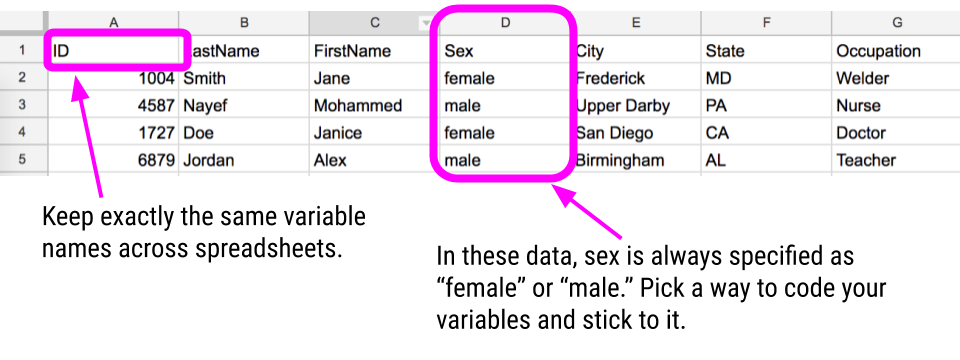{fig-align="center"}

## Escoge buenos nombres {.smaller}

::: incremental
-   Como ya habíamos mencionado, R puede presentar problemas con el nombre que le asignemos a nuestras columnas ("variables"):

    -   Si comienza con un número, antepondrá `X.` al nombre de la columna

    -   Si tiene caracteres especiales, puede dar problemas en el espaciado o de lectura

-   Adicionalmente, podemos mencionar las siguientes recomendaciones
:::

. . .

+-----------------------------------------------+-------------------+-------------------+
|                                               | Esto está bien    | ¡Evita esto!      |
+===============================================+===================+===================+
| Espacios extras                               | `"masculino"`     | `"masculino "`    |
+-----------------------------------------------+-------------------+-------------------+
| Usa guiones bajos en lugar de espacios vacíos | `cultivo_control` | `cultivo control` |
+-----------------------------------------------+-------------------+-------------------+
| Usa nombres informativos                      | `cultivo_control` | `C1`              |
+-----------------------------------------------+-------------------+-------------------+

## Fechas en formato ISO 8601

::: incremental
-   Ya habíamos mencionado anteriormente que dar formato a fechas puede resultar difícil (aunque no imposible).

-   Como parte de la consistencia, es recomendable que cuando trabajamos con fechas, registrarlas como "YYYY-MM-DD".

-   Este formato es conocido como ISO 8601 y es reconocido sin problema por R (y otros lenguajes).

-   Dependiendo de la configuración de nuestro ordenador, fechas en Excel como "14-Feb-23" pueden interpretarse mal o no reconocerse como fechas.
:::

## Evitar filas/celdas vacías

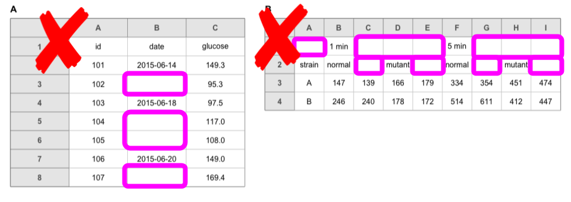{fig-align="center"}

## Una sola cosa a la vez

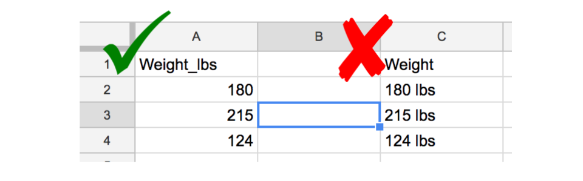{fig-align="center"}

## Evita resaltar/cambiar colores

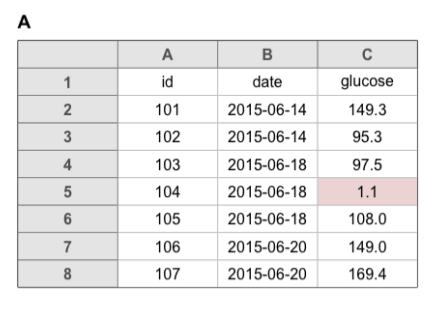{fig-align="center"}

## Ejemplos de tablas "problemáticas"

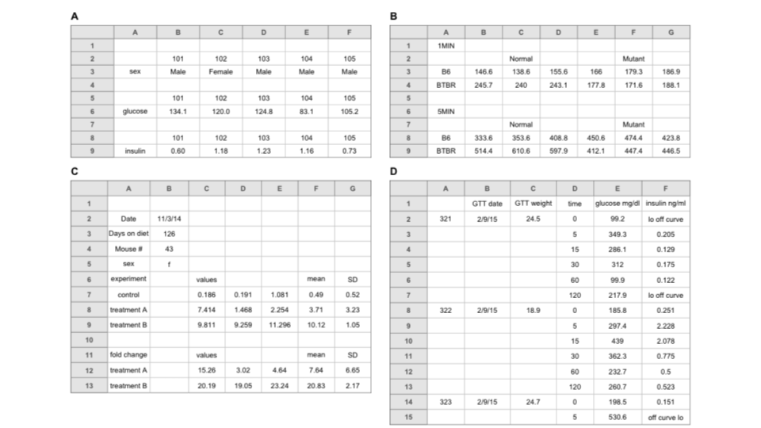{fig-align="center"}

## Ejemplos de tablas "problemáticas" {visibility="uncounted"}

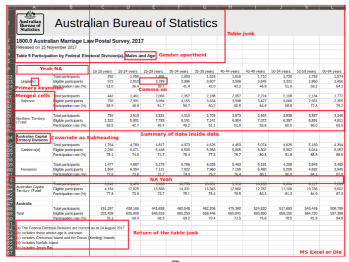{fig-align="center"}

## Principios de datos ordenados

::: incremental
-   Propuestos por [Hadley Wickham](https://en.wikipedia.org/wiki/Hadley_Wickham){target="_blank"} en su artículo titulado [*Tidy Data*](https://www.jstatsoft.org/article/view/v059i10){target="_blank"}.

-   Son sugerencias que Wickham formula para armonizar la manera de registrar datos y su posterior procesamiento en modelos de ciencias de datos (discutiblemente estas sugerencias ya existían inherentemente en el lenguaje SQL).

-   Tiene como premisa que los datos estén en una **tabla rectangular**: filas y columnas, sin celdas combinadas ni varias tablas en una misma hoja.

-   Las tablas rectangulares nacen de nuestra predisposición a registrar datos de esta manera.
:::

## Principio 1: Una columna por variable

{fig-align="center"}

## Principio 2: Una observación por fila

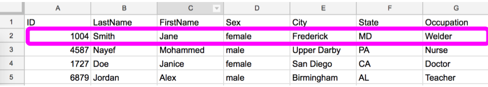{fig-align="center"}

## Principio 3: Una hoja de datos por tipo de datos

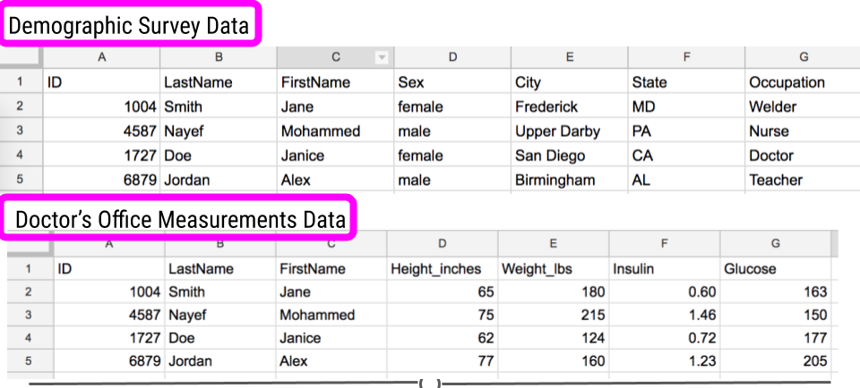{fig-align="center"}

## Principio 4: Una columna en común para unir tablas

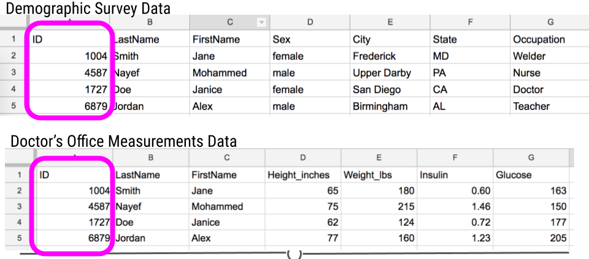{fig-align="center"}

# El `{tidyverse}`

## ¿Qué es el `{tidyverse}`? {.smaller}

::: columns
::: {.column width="35%"}
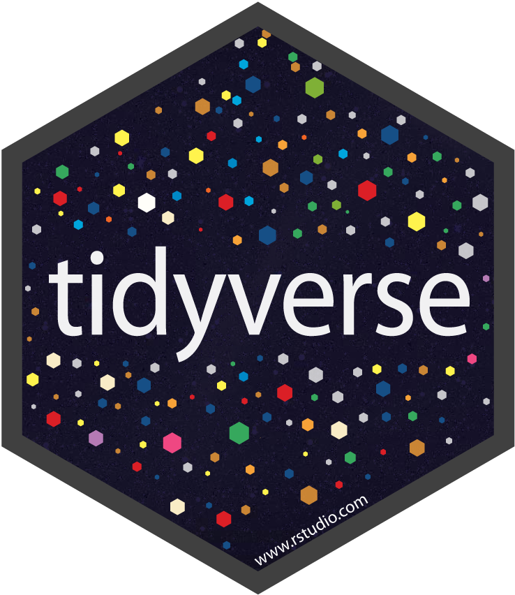{fig-align="center"}
:::

::: {.column width="65%"}
::: incremental
-   Una colección de paquetes que comparten una misma forma de trabajar con datos.
-   `{readr}` importa, `{tidyr}` ordena, `{dplyr}` transforma, `{ggplot2}` grafica.
-   Las funciones tienen nombres de **verbos**: `filter()`, `select()`, `mutate()`, `summarise()`.
-   Todas reciben una tabla como primer argumento y devuelven una tabla.
:::

::: {.fragment}
```{r}
#| eval: false

install.packages("tidyverse")
library(tidyverse)
```

:::

:::
:::

## Tibbles {.smaller}

::: incremental
-   Un `tibble` es un `data.frame` moderno: se imprime mejor (solo las primeras filas y el tipo de cada columna) y nunca cambia los nombres de las columnas.
-   Todo lo que funciona con un `data.frame` funciona con un `tibble`.
-   Para convertir: `as_tibble(tabla)` y `as.data.frame(tabla)`.
:::

## Operador de cascada {.smaller}

::: incremental
-   El operador de cascada: `%>%` es una función de la librería `{magrittr}`. 

-   Entendamos a `%>%` como la palabra "entonces". En términos sencillos, es algo como: "Tengo harina `%>%` hago pan"

-   En lenguaje R, esto se interpreta como si tuviéramos un objeto `A` sobre el cual deseamos aplicar una función `B`. Esto se vería como: `B(A)`

-   Alternativamente, podemos expresarlo como `A %>% B`.

-   En base R: `D(C(B(A)))`

-   Con el operador de cascada: `A %>% B %>% C %>% D`

:::

## Operador de cascada {.smaller visibility="uncounted"}

Sin el operador, leemos de adentro hacia afuera:

```{r}
round(mean(pinguinos$body_mass_g, na.rm = TRUE), 1)
```

. . .

Con `%>%`, leemos de izquierda a derecha, como una receta: "toma esto, **y luego** haz aquello".

```{r}
pinguinos$body_mass_g %>%
  mean(na.rm = TRUE) %>%
  round(1)
```

. . .

::: callout-tip
`x %>% f(y)` es lo mismo que `f(x, y)`. En RStudio: `Ctrl + Shift + M`. Desde la versión 4.1, R también tiene su propio operador, `|>`, que funciona casi igual; en este curso usaremos `%>%`.
:::


# Cambiar el formato con `{tidyr}`

## Formato ancho y formato largo {.smaller}

**De formato ancho a largo**

-   Utilizaremos la función `pivot_longer()` del paquete `{tidyr}` con la tabla de base `airquality`

-   Con `names_to` y `values_to` elegimos los nombres de las nuevas columnas.

. . .

```{r echo=T, eval=F}
tabla_larga <- airquality %>%
  pivot_longer(-c(Month, Day), names_to = "variable", values_to = "valores")
```

## Formato ancho y formato largo {.smaller visibility="uncounted"}

**De formato ancho a largo**

-   Utilizaremos la función `pivot_longer()` del paquete `{tidyr}` con la tabla de base `airquality`

-   Con `names_to` y `values_to` elegimos los nombres de las nuevas columnas.


```{r echo=T, eval=T}
tabla_larga <- airquality %>%
  pivot_longer(-c(Month, Day), names_to = "variable", values_to = "valores")

tabla_larga
```

## Formato ancho y formato largo {.smaller visibility="uncounted"}

**De formato largo a ancho**

-   Utilizaremos la función `pivot_wider()`: `names_from` indica de qué columna salen los nombres de las nuevas columnas y `values_from`, de cuál salen sus valores.

```{r echo=T, eval=F}
tabla_ancha <- tabla_larga %>%
  pivot_wider(names_from = "variable", values_from = "valores")
```

## Formato ancho y formato largo {.smaller visibility="uncounted"}

**De formato largo a ancho**

-   Utilizaremos la función `pivot_wider()`: `names_from` indica de qué columna salen los nombres de las nuevas columnas y `values_from`, de cuál salen sus valores.

```{r echo=T, eval=T}
tabla_ancha <- tabla_larga %>%
  pivot_wider(names_from = "variable", values_from = "valores")

tabla_ancha
```


# Operaciones con tablas en `{dplyr}`

## Filtrar filas: `filter()` {.smaller}

```{r}
pinguinos %>%
  filter(species == "Gentoo", body_mass_g > 5500)
```

. . .

Condiciones: `==`, `!=`, `>`, `<`, `%in%`, y `!is.na(x)` para descartar faltantes. Varias condiciones separadas por coma se cumplen **a la vez**.

## Seleccionar y ordenar: `select()` y `arrange()` {.smaller}

```{r}
pinguinos %>%
  select(species, island, body_mass_g) %>%
  arrange(desc(body_mass_g))
```

## Crear columnas: `mutate()` {.smaller}

```{r}
pinguinos %>%
  mutate(masa_kg = body_mass_g / 1000,
         pico_relativo = bill_length_mm / bill_depth_mm) %>%
  select(species, masa_kg, pico_relativo)
```

## Resumir por grupos: `group_by()` y `summarise()` {.smaller}

```{r}
pinguinos %>%
  filter(!is.na(body_mass_g)) %>%
  group_by(species) %>%
  summarise(n = n(),
            masa_media = mean(body_mass_g),
            masa_de = sd(body_mass_g))
```

. . .

`count(species, island)` es un atajo para contar combinaciones.

## {}

::: columns
::: {.column width="37.5%"}
:::

::: {.column width="60%"}
::: {.title data-id="title"}
[Ejercicios, Partes 1 y 2](../ejercicios-2.html#parte-1){target="_blank"}
:::

::: {.timer #Timer1 seconds=1500 starton=interaction}
:::
:::
:::

{.image-left}

# Introducción a `{ggplot2}`

## ¿Qué observas? {.smaller}

```{r}
#| echo: false
#| fig-height: 4.8
#| fig-width: 9
ggplot(pinguinos, aes(x = flipper_length_mm, y = body_mass_g)) +
  geom_point()
```

¿Qué relación ves? ¿Qué información falta en este gráfico?

## La gramática de los gráficos {.smaller}

::: columns
::: {.column width="45%"}
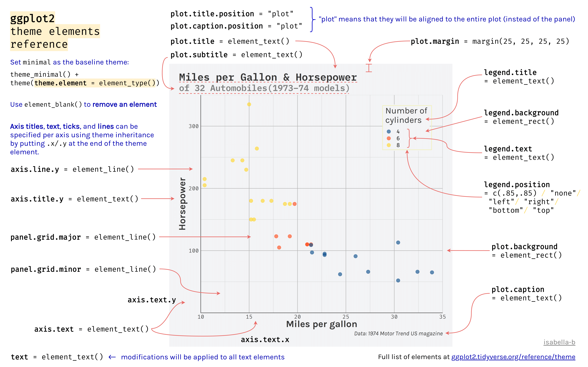{fig-align="center"}
:::

::: {.column width="55%"}
::: incremental
-   **Datos:** la tabla.
-   **Estéticas** (`aes()`): qué variable va en el eje x, en el eje y, en el color...
-   **Geometrías** (`geom_*()`): cómo se dibujan los datos (puntos, barras, cajas...).
-   **Capas:** se suman con `+`.
:::
:::
:::

## Función de inicio {.smaller}

```{r}
#| fig-height: 3.6
ggplot(data = pinguinos, mapping = aes(x = flipper_length_mm, y = body_mass_g))
```

`ggplot()` prepara el lienzo y los ejes, pero todavía no dibuja nada.

## Geometrías {.smaller}

```{r}
#| fig-height: 3.6
ggplot(pinguinos, aes(x = flipper_length_mm, y = body_mass_g)) +
  geom_point()
```

. . .

Otras: `geom_histogram()`, `geom_boxplot()`, `geom_bar()`, `geom_line()`, `geom_smooth()`...

## Mapeo estético {.smaller}

```{r}
#| fig-height: 4
ggplot(pinguinos, aes(x = flipper_length_mm, y = body_mass_g, color = species)) +
  geom_point()
```

Dentro de `aes()`, `color = species` **mapea** una variable a un color, y `{ggplot2}` agrega la leyenda.

## Dentro o fuera de `aes()` {.smaller}

::: columns
::: {.column width="50%"}
```{r}
#| fig-height: 4
ggplot(pinguinos, aes(x = flipper_length_mm,
                      y = body_mass_g)) +
  geom_point(color = "steelblue", size = 2)
```
:::

::: {.column width="50%"}
::: incremental
-   **Dentro** de `aes()`: el color *depende de una variable*.
-   **Fuera** de `aes()`, en la geometría: un valor *fijo* para todos los puntos.
-   Estéticas comunes: `color`, `fill`, `size`, `shape`, `alpha`.
:::
:::
:::

## Capas {.smaller}

```{r}
#| fig-height: 4
ggplot(pinguinos, aes(x = flipper_length_mm, y = body_mass_g, color = species)) +
  geom_point(alpha = 0.6) +
  geom_smooth(method = "lm", se = FALSE)
```

Cada `+` agrega una capa. Las estéticas de `ggplot()` las heredan todas las capas.

## Otras geometrías {.smaller}

::: columns
::: {.column width="50%"}
```{r}
#| fig-height: 4
ggplot(pinguinos, aes(x = body_mass_g)) +
  geom_histogram(binwidth = 250)
```
:::

::: {.column width="50%"}
```{r}
#| fig-height: 4
ggplot(pinguinos, aes(x = species, y = body_mass_g)) +
  geom_boxplot()
```
:::
:::

`{ggplot2}` avisa cuando descarta filas con `NA`; aquí, las dos sin masa.

## {}

::: columns
::: {.column width="37.5%"}
:::

::: {.column width="60%"}
::: {.title data-id="title"}
[Ejercicios, Parte 3](../ejercicios-2.html#parte-3){target="_blank"}
:::

::: {.timer #Timer2 seconds=900 starton=interaction}
:::
:::
:::

{.image-left}

## Antes de la próxima sesión {.smaller}

::: incremental
1.  Completa **todos** los [ejercicios](../ejercicios-2.html){target="_blank"} del Módulo 2: lo que no alcanzamos en clase, incluida la Parte 4, es tarea.
2.  Con tus propios datos, escribe una cadena de `{dplyr}` que resuma una variable por grupo, y haz un gráfico de dispersión.
3.  Haz la [autoevaluación](../autoevaluacion-2.html){target="_blank"} del Módulo 2.
:::

## {}

::: columns
::: {.column width="60%"}
::: {.title data-id="title"}
Fin del módulo 2
:::

::: callout-tip
## Créditos

Datos: Gorman KB, Williams TD, Fraser WR (2014), *PLoS ONE* 9(3): e90081, distribuidos en el paquete [`{palmerpenguins}`](https://allisonhorst.github.io/palmerpenguins/){target="_blank"} (CC0).

Foto final por <a href="https://unsplash.com/@alisonpang?utm_content=creditCopyText&utm_medium=referral&utm_source=unsplash">Alison Pang</a> en <a href="https://unsplash.com/photos/a-street-sign-on-the-side-of-a-road-RVIJvAMz6-M?utm_content=creditCopyText&utm_medium=referral&utm_source=unsplash">Unsplash</a>

Resto de fotos: varias fuentes
:::
:::

::: {.column width="37.5%"}
{style="margin-left:120px"}
:::
:::

{.image-right}
