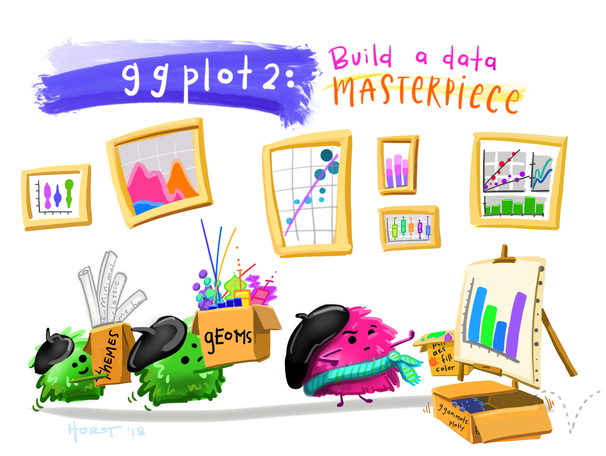

## {}

::: columns
::: {.column width="37.5%"}
{style="margin-left:-60px"}
:::

::: {.column width="60%"}
::: {.title data-id="title"}
Módulo 3: Visualización de datos con `{ggplot2}`
:::

Mauricio Moreno, PhD


:::
:::

{.image-left}

## Hoy

1.  Elegir el gráfico según las variables
2.  Gráficos comunes
3.  Figuras con estadísticos
4.  Gráficos especiales: facetas y mapas de calor
5.  Escalas, etiquetas y temas
6.  Exportar gráficos

## Los datos de hoy {.smaller}

```{r}
#| code-fold: true
library(tidyverse)
pinguinos <- read_csv("datos/pinguinos.csv") |>
  filter(!is.na(sex)) |>
  mutate(species = factor(species), sex = factor(sex), island = factor(island))
pinguinos
```

Quitamos las 11 filas sin sexo, para que no aparezca una categoría `NA` en los gráficos.

# Elegir el gráfico

## ¿Qué gráfico uso? {.smaller}

| Variables | Pregunta típica | Gráfico |
|:--|:--|:--|
| 1 categórica | ¿Cuántos hay de cada grupo? | barras: `geom_bar()` |
| 1 numérica | ¿Cómo se distribuye? | histograma, densidad: `geom_histogram()`, `geom_density()` |
| 2 categóricas | ¿Cómo se combinan? | barras apiladas o agrupadas: `geom_bar(position = ...)` |
| numérica y categórica | ¿Difieren los grupos? | cajas, violines, puntos: `geom_boxplot()`, `geom_violin()`, `geom_jitter()` |
| 2 numéricas | ¿Están relacionadas? | dispersión: `geom_point()` |
| numérica en el tiempo | ¿Cómo cambia? | líneas: `geom_line()` |

# Gráficos comunes

## Barras {.smaller}

::: columns
::: {.column width="50%"}
```{r}
ggplot(pinguinos, aes(x = species)) +
  geom_bar()
```
:::

::: {.column width="50%"}
```{r}
ggplot(pinguinos, aes(x = island, fill = species)) +
  geom_bar(position = "dodge")
```
:::
:::

`geom_bar()` cuenta las filas. Si ya tienes los conteos en una columna, usa `geom_col()`.

## Distribuciones {.smaller}

::: columns
::: {.column width="50%"}
```{r}
ggplot(pinguinos, aes(x = body_mass_g)) +
  geom_histogram(binwidth = 200,
                 color = "white")
```
:::

::: {.column width="50%"}
```{r}
ggplot(pinguinos, aes(x = body_mass_g, fill = species)) +
  geom_density(alpha = 0.5)
```
:::
:::

## Una numérica y una categórica {.smaller}

::: columns
::: {.column width="50%"}
```{r}
ggplot(pinguinos, aes(x = species, y = body_mass_g)) +
  geom_boxplot()
```
:::

::: {.column width="50%"}
```{r}
ggplot(pinguinos, aes(x = species, y = body_mass_g)) +
  geom_violin() +
  geom_jitter(width = 0.15, alpha = 0.4)
```
:::
:::

Con pocos datos, muestra los puntos: un diagrama de caja puede esconder cómo se reparten.

## Líneas {.smaller}

Datos `economics`, incluidos en `{ggplot2}`: desempleo mensual en EE. UU.

```{r}
#| fig-height: 3.6
#| fig-width: 11
ggplot(economics, aes(x = date, y = unemploy / 1000)) +
  geom_line() +
  labs(x = NULL, y = "Desempleados (millones)")
```

# Figuras con estadísticos

## Medias y barras de error {.smaller}

`stat_summary()` calcula el estadístico por nosotros: aquí, la media ± un error estándar.

```{r}
ggplot(pinguinos, aes(x = species, y = body_mass_g)) +
  geom_jitter(width = 0.15, alpha = 0.3) +
  stat_summary(fun.data = mean_se, color = "#D55E00", size = 0.8)
```

## Medias y barras de error, calculadas antes {.smaller}

```{r}
#| code-fold: true
resumen <- pinguinos |>
  group_by(species, sex) |>
  summarise(media = mean(body_mass_g),
            ee = sd(body_mass_g) / sqrt(n()), .groups = "drop")
```

```{r}
ggplot(resumen, aes(x = species, y = media, color = sex)) +
  geom_point(size = 3, position = position_dodge(width = 0.4)) +
  geom_errorbar(aes(ymin = media - ee, ymax = media + ee), width = 0.15,
                position = position_dodge(width = 0.4))
```

## Líneas de tendencia {.smaller}

```{r}
ggplot(pinguinos, aes(x = flipper_length_mm, y = body_mass_g, color = species)) +
  geom_point(alpha = 0.5) +
  geom_smooth(method = "lm")
```

`method = "lm"` ajusta una recta; la banda es su intervalo de confianza del 95%.

## {}

::: columns
::: {.column width="37.5%"}
:::

::: {.column width="60%"}
::: {.title data-id="title"}
[Ejercicios, Partes 1 y 2](../ejercicios-3.html#parte-1){target="_blank"}
:::

::: {.timer #Timer1 seconds=1500 starton=interaction}
:::
:::
:::

{.image-left}

# Gráficos especiales

## Facetas {.smaller}

::: columns
::: {.column width="50%"}
```{r}
ggplot(pinguinos, aes(x = flipper_length_mm,
                      y = body_mass_g)) +
  geom_point() +
  facet_wrap(~ species)
```
:::

::: {.column width="50%"}
```{r}
ggplot(pinguinos, aes(x = body_mass_g)) +
  geom_histogram(binwidth = 250) +
  facet_grid(sex ~ species)
```
:::
:::

`facet_wrap(~ a)`: un panel por nivel. `facet_grid(filas ~ columnas)`: una cuadrícula con dos factores.

## Mapas de calor {.smaller}

```{r}
#| code-fold: true
conteos <- pinguinos |> count(species, island)
```

```{r}
#| fig-height: 3.6
ggplot(conteos, aes(x = island, y = species, fill = n)) +
  geom_tile(color = "white") +
  geom_text(aes(label = n)) +
  scale_fill_gradient(low = "#e8f1f8", high = "#1f5f8b")
```

# Escalas, etiquetas y temas

## Un gráfico por defecto... {.smaller}

```{r}
p <- ggplot(pinguinos, aes(x = bill_length_mm, y = bill_depth_mm, color = species)) +
  geom_point()
p
```

. . .

Un gráfico es un **objeto**: lo guardamos en `p` y le seguimos sumando capas.

## ...paso a paso, listo para un informe {.smaller}

```{r}
#| fig-height: 4.4
p +
  scale_color_manual(values = c(Adelie = "#E69F00", Chinstrap = "#56B4E9", Gentoo = "#009E73")) +
  labs(x = "Largo del pico (mm)", y = "Profundidad del pico (mm)", color = "Especie",
       title = "Cada especie tiene una forma de pico distinta",
       caption = "Datos: Gorman et al. (2014), {palmerpenguins}") +
  theme_minimal(base_size = 14) +
  theme(legend.position = "bottom")
```

## Escalas y paletas {.smaller}

::: incremental
-   `scale_color_*()` y `scale_fill_*()` controlan los colores: `_manual()`, `_brewer()`, `_viridis_d()` (discreta) y `_viridis_c()` (continua).
-   Usa paletas aptas para **daltonismo**: viridis u Okabe-Ito (la del gráfico anterior).
-   `scale_x_continuous()` y `scale_y_continuous()`: límites, cortes y etiquetas de los ejes.
-   `scale_y_log10()`: eje logarítmico.
:::

## Temas {.smaller}

::: columns
::: {.column width="50%"}
```{r}
#| fig-height: 3.4
p + theme_bw()
```
:::

::: {.column width="50%"}
```{r}
#| fig-height: 3.4
p + theme_classic()
```
:::
:::

`theme()` ajusta cualquier detalle: tamaño del texto, posición de la leyenda, líneas de la cuadrícula...

# Exportar gráficos

## `ggsave()` {.smaller}

```{r}
#| eval: false
grafico <- p + theme_minimal()

ggsave("resultados/picos.png", plot = grafico, width = 16, height = 10, units = "cm", dpi = 300)
ggsave("resultados/picos.pdf", plot = grafico, width = 16, height = 10, units = "cm")
```

::: incremental
-   **png** con `dpi = 300` para Word y presentaciones; **pdf** o **svg** (vectoriales) para publicaciones.
-   Fija `width` y `height`: si no, el tamaño depende de la ventana de RStudio.
:::

## Combinar gráficos con `{patchwork}` {.smaller}

```{r}
#| fig-height: 3.8
#| fig-width: 11
library(patchwork)
g1 <- ggplot(pinguinos, aes(x = species, y = body_mass_g)) + geom_boxplot()
g2 <- ggplot(pinguinos, aes(x = flipper_length_mm, y = body_mass_g)) + geom_point()
g1 + g2 + plot_annotation(tag_levels = "A")
```

## {}

::: columns
::: {.column width="37.5%"}
:::

::: {.column width="60%"}
::: {.title data-id="title"}
[Ejercicios, Parte 3](../ejercicios-3.html#parte-3){target="_blank"}
:::

::: {.timer #Timer2 seconds=900 starton=interaction}
:::
:::
:::

{.image-left}

## Antes de la próxima sesión {.smaller}

::: incremental
1.  Completa **todos** los [ejercicios](../ejercicios-3.html){target="_blank"} del Módulo 3: lo que no alcanzamos en clase, incluida la Parte 4, es tarea.
2.  Con tus propios datos, haz un gráfico listo para un informe y expórtalo con `ggsave()`.
3.  Haz la [autoevaluación](../autoevaluacion-3.html){target="_blank"} del Módulo 3.
:::

## {}

::: columns
::: {.column width="60%"}
::: {.title data-id="title"}
Fin del módulo 3
:::

::: callout-tip
## Créditos

Datos: Gorman KB, Williams TD, Fraser WR (2014), *PLoS ONE* 9(3): e90081, distribuidos en el paquete [`{palmerpenguins}`](https://allisonhorst.github.io/palmerpenguins/){target="_blank"} (CC0).

Foto final por <a href="https://unsplash.com/@prphotography262?utm_content=creditCopyText&utm_medium=referral&utm_source=unsplash">Peter Robbins</a> en <a href="https://unsplash.com/photos/a-red-and-white-sign-sitting-on-the-side-of-a-road-i1zJw2smw_I?utm_content=creditCopyText&utm_medium=referral&utm_source=unsplash">Unsplash</a>

Resto de fotos: varias fuentes
:::
:::

::: {.column width="37.5%"}
{style="margin-left:120px"}
:::
:::

{.image-right}
