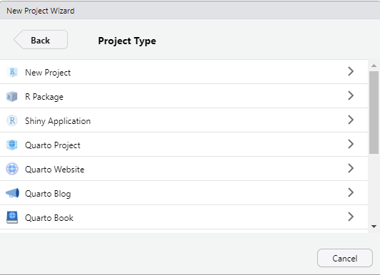
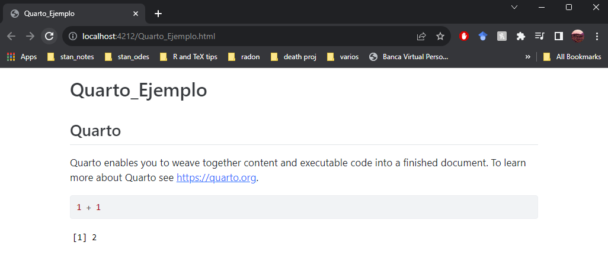
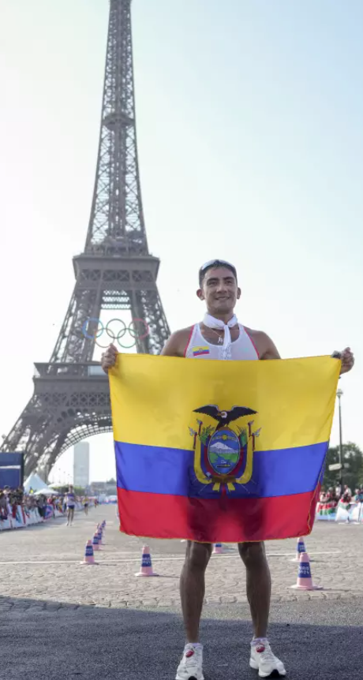

## {}

::: columns
::: {.column width="37.5%"}
{style="margin-left:-50px"}
:::

::: {.column width="60%"}
::: {.title data-id="title"}
Módulo 4: Introducción a Quarto
:::

Mauricio Moreno, PhD


:::
:::

{.image-left}

## Hoy

1.  ¿Qué es Quarto?
2.  Preparar el ambiente de trabajo
3.  Estructura básica de un documento
4.  Figuras y tablas
5.  Generar reportes en html, Word y PDF
6.  Cierre del curso, examen y certificado

# ¿Qué es Quarto?

## Del script al reporte {.smaller}

::: incremental
-   Hasta ahora: un script con el código, y luego copiar y pegar números y gráficos en Word.
-   Si cambian los datos, hay que repetir todo a mano, y es fácil equivocarse.
-   **Quarto** junta en un solo archivo (`.qmd`) el **texto**, el **código** y sus **resultados**.
-   Al presionar **Render**, Quarto ejecuta el código y genera el documento: html, Word, PDF, presentaciones o sitios web.
-   Estas diapositivas y la página del curso están hechas con Quarto.
:::

# Preparar el ambiente

## Instalación {.smaller}

::: incremental
-   Quarto viene incluido en las versiones recientes de RStudio. Comprueba con **File → New File → Quarto Document...**
-   Para documentos en **PDF** hace falta LaTeX. La forma más sencilla es TinyTeX:
:::

. . .

```{r}
#| eval: false
install.packages("tinytex")
tinytex::install_tinytex()
```

## Un proyecto de Quarto {.smaller}

::: columns
::: {.column width="40%"}
{fig-align="center"}
:::

::: {.column width="60%"}
1.  *File* → *New Project...*
2.  *New Directory* → *Quarto Project*
3.  Elegimos el nombre y la ubicación de la carpeta → *Create Project*.
:::
:::

## Un proyecto de Quarto {visibility="uncounted" .smaller}

RStudio crea un documento de ejemplo. Presiona **Render**:

{fig-align="center"}

# Estructura básica

## Las tres partes de un documento {.smaller}

````markdown
---
title: "Pingüinos del archipiélago Palmer"
author: "Tu nombre"
format: html
---

## Introducción

Analizamos la **masa corporal** de tres especies de pingüinos.

```{{r}}
library(tidyverse)
pinguinos <- read_csv("datos/pinguinos.csv")
```
````

1.  **Encabezado YAML**, entre `---`: título, autor, formato.
2.  **Texto** en Markdown.
3.  **Fragmentos de código** (*chunks*), entre ```` ``` ````.

## Markdown en un minuto {.smaller}

| Escribes | Obtienes |
|:--|:--|
| `## Título de sección` | un título de segundo nivel |
| `**negrita**`, `*cursiva*` | **negrita**, *cursiva* |
| `- elemento` | una lista |
| `[texto](https://quarto.org)` | un enlace |
| `` `código` `` | `código` en línea |
| `$\bar{x}$` | $\bar{x}$ |

. . .

Y código en línea: `` `r knitr::inline_expr("nrow(pinguinos)")` `` escribe el número de filas dentro del texto, y se actualiza solo.

## Opciones de los fragmentos {.smaller}

````markdown
```{{r}}
#| label: importar
#| echo: false
#| message: false
library(tidyverse)
```
````

| Opción | Qué hace |
|:--|:--|
| `echo: false` | muestra el resultado pero no el código |
| `eval: false` | muestra el código pero no lo ejecuta |
| `include: false` | ejecuta, pero no muestra nada |
| `warning: false`, `message: false` | oculta advertencias y mensajes |

## Opciones globales {.smaller}

Para todo el documento, en el encabezado:

````markdown
---
title: "Pingüinos del archipiélago Palmer"
format: html
execute:
  echo: false
  warning: false
---
````

. . .

::: callout-tip
En un reporte para otras personas, lo habitual es `echo: false`: se ven los resultados, no el código.
:::

# Figuras y tablas

## Figuras {.smaller}

````markdown
```{{r}}
#| label: fig-masa
#| fig-cap: "Masa corporal por especie."
#| fig-width: 6
#| fig-height: 4
ggplot(pinguinos, aes(x = species, y = body_mass_g)) +
  geom_boxplot()
```

Como se ve en la @fig-masa, los Gentoo son los más pesados.
````

::: incremental
-   Una etiqueta que empieza con `fig-` numera la figura y permite citarla con `@fig-masa`.
-   `fig-width` y `fig-height`, en pulgadas.
-   Para una imagen guardada: `{width=50%}`.
:::

## Tablas {.smaller}

````markdown
```{{r}}
#| label: tbl-masa
#| tbl-cap: "Masa corporal media por especie (g)."
pinguinos |>
  group_by(species) |>
  summarise(n = n(), masa_media = mean(body_mass_g, na.rm = TRUE)) |>
  knitr::kable(digits = 0)
```
````

. . .

```{r}
#| echo: false
library(tidyverse)
read_csv("datos/pinguinos.csv") |>
  group_by(species) |>
  summarise(n = n(), masa_media = mean(body_mass_g, na.rm = TRUE)) |>
  knitr::kable(digits = 0)
```

# Generar reportes

## html, Word y PDF {.smaller}

````markdown
---
title: "Pingüinos del archipiélago Palmer"
format:
  html: default
  docx: default
  pdf: default
---
````

::: incremental
-   El mismo `.qmd` produce los tres formatos. En RStudio, la flecha junto a **Render** elige cuál.
-   **html:** el más rico (interactivo, sin instalar nada más).
-   **docx:** para quien necesita editar en Word.
-   **pdf:** necesita TinyTeX.
:::

## {}

::: columns
::: {.column width="37.5%"}
:::

::: {.column width="60%"}
::: {.title data-id="title"}
[Ejercicios](../ejercicios-4.html#parte-1){target="_blank"}
:::

::: {.timer #Timer1 seconds=2400 starton=interaction}
:::
:::
:::

{.image-left}

# Cierre del curso

## Lo que vimos en cuatro sesiones {.smaller}

| Módulo | Lo que ya puedes hacer con R |
|:--|:--|
| 1 | Trabajar en un proyecto, importar datos y calcular estadísticos básicos. |
| 2 | Transformar y resumir tablas con `{dplyr}`, y hacer los primeros gráficos. |
| 3 | Elegir, mejorar y exportar gráficos con `{ggplot2}`. |
| 4 | Reunir análisis, figuras y texto en un reporte reproducible. |

## Examen y certificado {.smaller}

::: incremental
-   El **examen** estará disponible a partir del . Vale el **60%** de la nota; los ejercicios en clase, el **40%**.
-   Tiene dos partes: un **script de R para completar** (datos y gráficos) y un **reporte de Quarto** corto. Entregas los dos archivos.
-   Con **7/10** obtienes el certificado de aprobación; si no, el de asistencia.
-   Antes del examen, completa **todos** los [ejercicios](../ejercicios-4.html){target="_blank"} del Módulo 4 y repasa las [autoevaluaciones](../autoevaluacion-1.html){target="_blank"}.
:::

## {}

::: columns
::: {.column width="60%"}
::: {.title data-id="title"}
¡Gracias!
:::

::: callout-tip
## Créditos de fotos

Portada por <a href="https://unsplash.com/@florianklauer?utm_content=creditCopyText&utm_medium=referral&utm_source=unsplash">Florian Klauer</a> en <a href="https://unsplash.com/photos/black-fayorit-typewriter-with-printer-paper-mk7D-4UCfmg?utm_content=creditCopyText&utm_medium=referral&utm_source=unsplash">Unsplash</a>

Foto final por <a href="https://unsplash.com/@kipfarl?utm_content=creditCopyText&utm_medium=referral&utm_source=unsplash">Julian Rösner</a> en <a href="https://unsplash.com/photos/a-long-dock-with-benches-in-the-water-2knUR_Kyq24?utm_content=creditCopyText&utm_medium=referral&utm_source=unsplash">Unsplash</a>

Resto de fotos: varias fuentes
:::
:::

::: {.column width="37.5%"}
{style="margin-left:120px"}
:::
:::

{.image-right}
